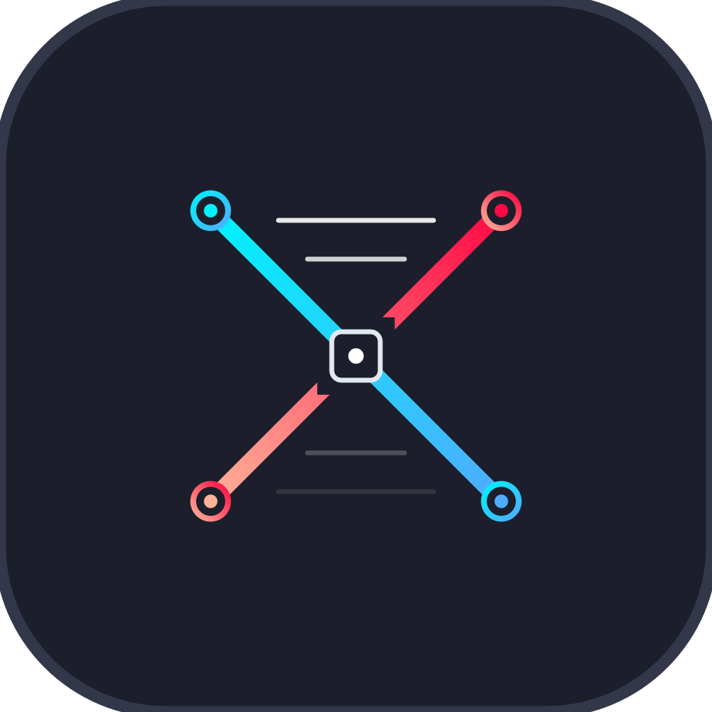
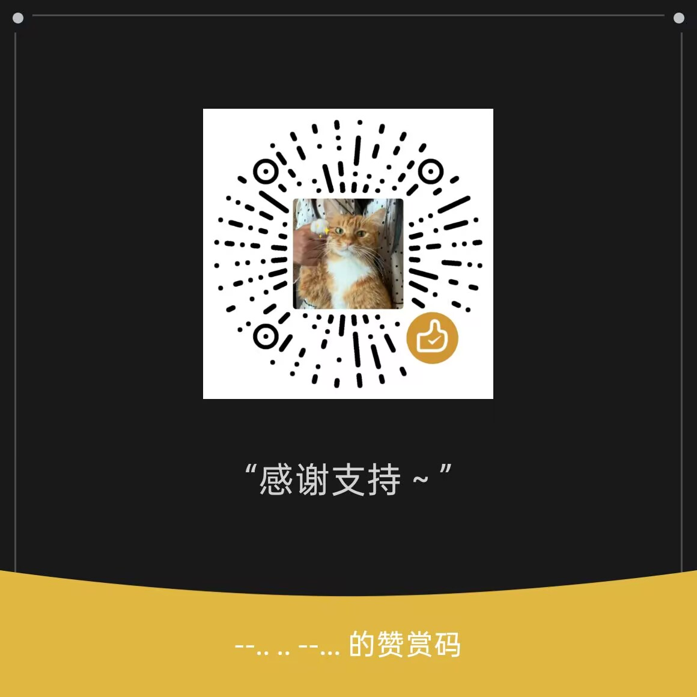

  
  <h1>Nyxion Ecosystem</h1>
  
<b>多端互联的下一代个人 AI 生态矩阵</b> Decentralized, Multi-Device Interconnected AI Ecosystem

  
  
  
  

---

> 『我曾幻想过一个没有隔阂的世界。所以我做了这个项目。』

## 🌌 什么是 NyXion？

**NyXion** 是一套旨在打破硬件孤岛、实现深度多端互联的底层生态矩阵。鉴于我懒得编且懒得让AI编，所以没什么好说的。

## 🧩 核心生态

Nyxion 生态由多个高度解耦、独立演进的核心子项目构成：

| 模块 | 定位 | 核心能力 |
| :--- | :--- | :--- |
|  **[幻想生命](https://github.com/NyXion-EcoWarehouse/NyXion-Life)** | **？？？** | Gestalt高级版专享，暂时保密~ *(暂未上线)* |
|  **[Gestalt](https://github.com/NyXion-EcoWarehouse/NyXion-Gestalt)** | **主脑** | 承载底层状态机、多级分片记忆库、整合多CLI框架的核心。它是整个生态的中枢神经系统。*(暂未上线)* |
|  **[Heredity](https://github.com/NyXion-EcoWarehouse/NyXion-Heredity)** | **适配器** | 为Gestalt链接外围 App 而生，原生兼容 OneBot 标准协议。*(开发中)* |
|  **[Relay](https://github.com/NyXion-EcoWarehouse/NyXion-Relay)** | **流转** | 传递个人数据的通讯核心。*(暂未上线)* |
|  **[Vita](https://github.com/NyXion-EcoWarehouse/NyXion-Vita)** | **健康** | 采集健康数据，传递给Gestalt的中枢。*(暂未上线)* |
|  **[Synapse](https://github.com/NyXion-EcoWarehouse/NyXion-Synapse)** | **端口映射** | 负责跨设备的底层网络穿透与点对点端口映射。*(暂未上线)* |
|  **[Aegis](https://github.com/NyXion-EcoWarehouse/NyXion-Aegis)** | **安全** | 贯穿部分生态的安全免疫系统。*(暂未上线)* |

## 🚀 快速上手

目前生态各模块正在缓慢迭代开发中。你可以前往各个子项目的仓库查看详细的部署与开发文档：
*   [NyXion-Gestalt 部署指南](./NyXion-Gestalt)
*   [NyXion-Heredity 配置说明](./NyXion-Heredity)
*   [NyXion-Relay 配置说明](./NyXion-Relay)
*   [NyXion-Vita 配置说明](./NyXion-Vita)
*   [NyXion-Synapse 配置说明](./NyXion-Synapse)
*   [NyXion-Aegis 功能详解](./NyXion-Aegis)
*   其实现在点哪个都没用，因为压根还没写。

## ⚖️ 授权许可与免责声明

Nyxion 生态采用**核心闭源与外围开源相结合**的生态策略：
*   **外围生态**：`Heredity`（通讯桥梁）及插件 SDK 采用 `MIT` 协议开源，鼓励社区共同扩展外围兼容性。
*   **核心中枢**：`Gestalt`（主脑架构）、安全模块（`Aegis`）与幻想生命（`Life`）作为核心资产，采用闭源分发。软件分为普通版与高级版，禁止任何形式的逆向工程与破解。
~~（而且其实高级版就比普通版多了一个幻想生命支持，这玩意还贼拉吃硬件。除非你真的打算养一个数字生命，否则普通版就够了。）~~

在使用本生态任何组件前，请务必[阅读完整的用户协议与免责声明 (EULA)](./EULA.md)。

## 💖 为 Nyxion 的星火添一把柴

如果你愿意的话，可以点击下方展开赞助码，请开发者喝杯咖啡。开发不易，Vibe烧钱。

👉 点击这里展开赞助码

 

  <table style="border-collapse: collapse; border: none;">
    <tr>
      <td align="center" style="padding: 15px; border: none;">
        
          
        <b>支付宝 (Alipay)</b>
      </td>
      <td align="center" style="padding: 15px; border: none;">
        
          
        <b>微信 (WeChat)</b>
      </td>
    </tr>
  </table>

---

  <i>"欢迎使用NyXion生态。这里是唯一开发者江羽烨，在此向您致意。"</i>

